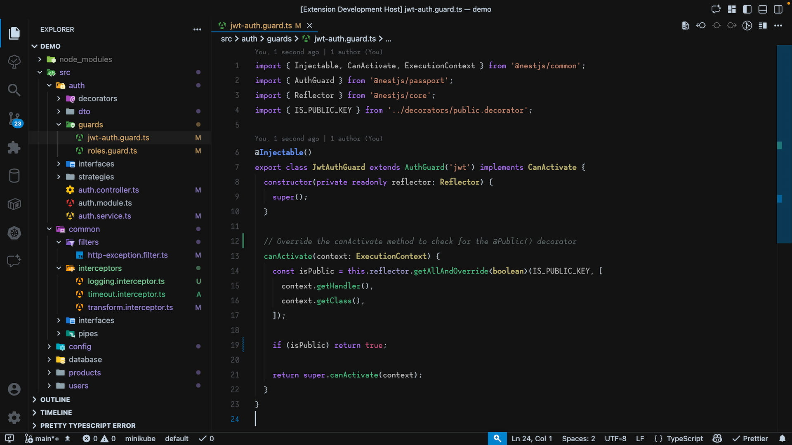

# Dev Theme Pro 🔮

> A polished dark theme with a built-in toolkit for Markdown, Mermaid, CSV, PDF export, and shareable code snapshots.

  

Dev Theme Pro started as a theme obsession. It now ships the tools you keep reaching for while you work: a better Markdown preview, a cleaner CSV viewer, reliable Mermaid export, and fast code snapshots without a pile of extra extensions.

---

## Why Install It?

| Area           | What you get                                                                                                             |
| -------------- | ------------------------------------------------------------------------------------------------------------------------ |
| **Theme**      | Four tuned dark variants with deliberate syntax color, cleaner UI contrast, and a consistent accent across the workbench |
| **Markdown**   | Rich preview, Mermaid rendering, table of contents, presentation mode, and one-click PDF/HTML export                     |
| **Data Files** | CSV/TSV preview with sorting, filtering, column resize, row numbers, and export to PDF/PNG/HTML                          |
| **Sharing**    | Live code snapshot preview with retina PNG export and whole-file fallback when nothing is selected                       |

---

## Installation

1. Open **Extensions** in VS Code (`Ctrl+Shift+X` / `Cmd+Shift+X`)
2. Search for **Dev Theme Pro**
3. Click **Install**
4. Open **File → Preferences → Color Theme** and choose your variant

---

## Pick Your Variant

Dev Theme Pro currently ships four theme variants:

- **Ocean Mist** — calm blue accent on the lighter dark base
- **Nebula Mist** — richer purple accent on the lighter dark base
- **Ocean Void** — deeper contrast with the blue accent
- **Nebula Void** — deeper contrast with the purple accent

If you want a quick default: **Mist** is easier on long sessions, and **Void** feels tighter and more contrast-heavy.

---

## Markdown Preview

Open any Markdown file in a Dev Theme Pro reading view that actually feels finished.

### Open It Your Way

| Action                        | How                                                                                |
| ----------------------------- | ---------------------------------------------------------------------------------- |
| Preview to the side           | Click the preview button in the editor title bar, or press `Cmd+K V` / `Ctrl+K V`  |
| Preview in the current editor | Click the render button in the title bar, or press `Cmd+K Cmd+V` / `Ctrl+K Ctrl+V` |
| Open With                     | Right-click the file tab and choose **Open With… → Dev Theme Pro**                 |

### What You Get

- **Theme-matched reading layout** — headings, tables, code blocks, and long docs feel like part of the theme instead of a generic web page
- **Full Mermaid support** — diagrams render inside the preview and can be downloaded as PNGs
- **Cleaner PDF export** — Mermaid diagrams export without the blank spacer pages that usually ruin long documents
- **Table of contents sidebar** — jump through large docs without losing your place
- **Presentation mode** — turn heading-based sections into slides and navigate with the keyboard
- **Standalone HTML export** — save a portable, styled version of the document for sharing

PDF export uses Chrome or Chromium automatically. If VS Code cannot find it, set `devThemePro.chromePath` in Settings.

---

## CSV / TSV Preview

Open `.csv`, `.tsv`, or `.psv` files in a table view that is built for real inspection work, not just quick glances.

| Feature       | What it does                                            |
| ------------- | ------------------------------------------------------- |
| Sorting       | Click any column header to sort ascending or descending |
| Filtering     | Use the search box to narrow rows instantly             |
| Column resize | Drag column borders to fit the data you care about      |
| Row numbers   | Keep references stable while reviewing large files      |
| Export        | Save the table as PDF, PNG, or standalone HTML          |

---

## Code Snapshot

Turn code into a clean, theme-matched PNG in a few seconds.

1. Open a code file
2. Select the lines you want to capture, or leave the selection empty to use the whole file
3. Press `Cmd+Shift+S` / `Ctrl+Shift+S`, or use **🔮 Dev Theme Pro → 📸 Code Snapshot** from the editor context menu
4. Review the live preview in the side panel
5. Save the final PNG at 2× retina resolution

The snapshot uses Dev Theme Pro styling instead of a generic export theme, so what you share still looks like your workspace.

---

## Shortcuts

| Command                          | Mac           | Windows / Linux |
| -------------------------------- | ------------- | --------------- |
| Open Markdown Preview (side)     | `Cmd+K V`     | `Ctrl+K V`      |
| Open Markdown Preview (in-place) | `Cmd+K Cmd+V` | `Ctrl+K Ctrl+V` |
| Open CSV Preview (side)          | `Cmd+K V`     | `Ctrl+K V`      |
| Code Snapshot                    | `Cmd+Shift+S` | `Ctrl+Shift+S`  |

All commands are also available from the **Command Palette**. Search for **Dev Theme Pro**.

---

## Right-Click Tools Menu

All extension features are grouped under a single **🔮 Dev Theme Pro** submenu in the editor context menu.

- **Markdown files** — open preview, export PDF, export HTML
- **CSV/TSV files** — open preview, export PDF/PNG/HTML
- **Code files** — create a code snapshot

---

## Why The Theme Itself Stands Out

- **Syntax colors that mean something** — keywords, functions, types, strings, and constants are easy to tell apart at a glance
- **Consistent accent across the whole UI** — tree view, command palette, autocomplete, badges, and scrollbars all speak the same visual language
- **Cleaner floating surfaces** — hovers, suggestions, and overlays separate clearly without noisy borders everywhere
- **Git and diagnostics stay readable** — diffs, status colors, and problem states stay aligned with the theme instead of feeling bolted on

---

## Settings

| Setting                  | Type     | Default | Description                                                                          |
| ------------------------ | -------- | ------- | ------------------------------------------------------------------------------------ |
| `devThemePro.chromePath` | `string` | `""`    | Path to Chrome or Chromium for PDF and image export. Leave empty for auto-detection. |

---

## Screenshot

---

## Changelog

See [CHANGELOG.md](CHANGELOG.md) for full release notes.

## Issues & Suggestions

Found something off or want another feature?
→ [Open an issue on GitHub](https://github.com/FaizanAshiq/dev-theme-pro/issues)

## Author

**Faizan Ashiq** — [LinkedIn](https://www.linkedin.com/in/faizanashiq/) · [GitHub](https://github.com/FaizanAshiq)

## License

MIT © 2025–2026 Faizan Ashiq — [Full License](LICENSE.txt)

---

**If Dev Theme Pro is your daily driver, a ⭐ review on the [VS Code Marketplace](https://marketplace.visualstudio.com/items?itemName=FaizanAshiq.dev-theme-pro) helps a lot.**
